# Product Requirements Document (PRD)
## CliniCore EHR — Enterprise Electronic Health Record & Clinical Management Platform

---

### Document Control
* **Document Title:** Product Requirements Document (PRD)
* **Project Name:** CliniCore EHR (Electronic Health Record & Medical Registry System)
* **Version:** 1.0.0 (Production Release)
* **Status:** Approved / Active
* **Date:** November 24, 2026
* **Owner:** Clinical Informatics & Engineering Team
* **Target Audience:** Product Managers, Software Engineers, Hospital Administrators, Clinical Staff

---

## 1. Executive Summary & Vision

### 1.1 Product Vision
**CliniCore EHR** is an enterprise-grade, serverless Electronic Health Record (EHR) and clinical management system designed for hospitals, outpatient clinics, and healthcare practices. The platform streamlines patient demographic management, clinical encounter recording, diagnostic tracking, lab investigations, medication orders, automated billing, follow-up scheduling, and patient messaging via WhatsApp.

### 1.2 Core Objectives
* **Unified Clinical Chart:** Provide physicians and nurses with an instant 360-degree timeline of patient history (visits, diagnoses, lab tests, prescriptions, invoices, and follow-ups).
* **Zero-Infrastructure Cost:** Deployable on a 100% free-tier serverless cloud architecture (Vercel Edge + TiDB Cloud Serverless MySQL) with zero server maintenance overhead.
* **Patient-Centric Communication:** Bridge the hospital-patient communication gap through instant, automated WhatsApp prescription summaries and appointment follow-up reminders.
* **Healthcare Security Compliance:** Enforce Role-Based Access Control (RBAC), cryptographic password hashing, strict CSRF defense, brute-force mitigation, and OWASP Top 10 security standards.

---

## 2. User Personas & Stakeholders

| Persona | Role | Key Responsibilities | Primary Needs in CliniCore |
| :--- | :--- | :--- | :--- |
| **Dr. Rajesh Gupta** | Attending Physician / Specialist | Patient diagnosis, treatment plans, prescribing medication, reviewing laboratory reports. | Rapid charting, access to past encounters, one-click WhatsApp prescription generation, clear disease histories. |
| **Nurse Priya Sharma** | Registered Clinical Nurse | Vitals collection, lab result entry, follow-up updates, patient queue management. | Fast search by patient name/phone, simple lab result logging, clear overdue follow-up alerts. |
| **Hospital Administrator** | Practice / Clinic Admin | Staff credential management, role assignment, billing overview, population health analytics. | User management (active/inactive states), revenue monitoring, patient age/disease distribution analytics. |
| **Patient / Guardian** | End Beneficiary | Receiving medical advice, adhering to prescriptions, attending scheduled reviews. | Frictionless digital access to legible prescriptions and follow-up notices on WhatsApp without requiring app downloads. |

---

## 3. Role-Based Access Control (RBAC) Specification

CliniCore enforces granular permission strings across all HTTP endpoints and views:

```mermaid
graph TD
    Admin["Admin (System Superuser)"] -->|"Full CRUD"| Patients["Patients & Demographics"]
    Admin -->|"Full CRUD"| Encounters["Visits & Encounters"]
    Admin -->|"Full CRUD"| Labs["Lab Results & Diagnostics"]
    Admin -->|"Full CRUD"| Meds["Medications & Rx"]
    Admin -->|"Full CRUD"| FollowUps["Follow-Up Tracking"]
    Admin -->|"Management"| UserAccounts["User Accounts & RBAC"]
    Admin -->|"Reports"| Analytics["Hospital Analytics"]

    Doctor["Doctor (Clinical Care)"] -->|"View / Add / Edit"| Patients
    Doctor -->|"View / Add"| Encounters
    Doctor -->|"View / Add"| Labs
    Doctor -->|"View / Add"| Meds
    Doctor -->|"View / Add / Edit"| FollowUps
    Doctor -->|"View"| Analytics

    Nurse["Nurse (Ward Support)"] -->|"View Only"| Patients
    Nurse -->|"View Only"| Encounters
    Nurse -->|"View / Add"| Labs
    Nurse -->|"View Only"| Meds
    Nurse -->|"View / Status Update"| FollowUps
```

### 3.1 Permission Matrix

| Feature / Permission Key | Admin | Doctor | Nurse |
| :--- | :---: | :---: | :---: |
| `patients.view` | Yes | Yes | Yes |
| `patients.add` | Yes | Yes | No |
| `patients.edit` | Yes | Yes | No |
| `patients.delete` | Yes | No | No |
| `visits.view` | Yes | Yes | Yes |
| `visits.add` | Yes | Yes | No |
| `diagnoses.view` / `diagnoses.add` | Yes | Yes | Yes (View) |
| `labs.view` | Yes | Yes | Yes |
| `labs.add` | Yes | Yes | Yes |
| `medications.view` | Yes | Yes | Yes |
| `medications.add` | Yes | Yes | No |
| `follow_ups.view` | Yes | Yes | Yes |
| `follow_ups.add` / `follow_ups.edit` | Yes | Yes | Yes (Status only) |
| `follow_ups.delete` | Yes | No | No |
| `ehr.view` | Yes | Yes | No |
| `analytics.view` | Yes | Yes | No |
| `admin.users` | Yes | No | No |

---

## 4. Functional Requirements

### 4.1 Module 1: Patient Demographics & Master Registry
* **FR-1.1:** System shall store patient full name, age (1–150), gender (`Male`, `Female`, `Other`), and 10-digit mobile phone contact.
* **FR-1.2:** System shall generate an immutable alphanumeric Medical Record Number (`#P0001`).
* **FR-1.3:** Real-time search by patient name or phone number with server-side pagination (25 records per page).
* **FR-1.4:** Individual Patient Chart view consolidating all clinical visits, diagnoses, lab investigations, medications, billing invoices, and scheduled follow-ups into a unified card timeline.

### 4.2 Module 2: Clinical Encounters & Visits
* **FR-2.1:** Record doctor name, visit date, and linked patient ID.
* **FR-2.2:** Automatically link visit encounters to billing invoice records (`INV-xxxxxx`) with standard consultation fees and payment status tracking.
* **FR-2.3:** Provide direct quick-access links from visit records to comprehensive print layouts and WhatsApp dispatches.

### 4.3 Module 3: Diagnostics & Laboratory Investigations
* **FR-3.1:** Log disease diagnoses associated with specific visit encounters.
* **FR-3.2:** Record diagnostic tests (e.g., Blood Pressure, Fasting Blood Sugar, HbA1c, TSH, MRI, ECG, X-Ray) with quantitative and qualitative result values.
* **FR-3.3:** Flag high-frequency conditions across the clinic to track local epidemiological patterns.

### 4.4 Module 4: Pharmacy & Medication Management
* **FR-4.1:** Prescribe drugs with brand/generic names and structured dosage instructions (e.g., `500 mg BD`, `5 mg OD`, `SOS`).
* **FR-4.2:** Printable clinical prescription slip featuring hospital letterhead, doctor information, patient demographics, clinical diagnoses, Rx list, and doctor signature block.

### 4.5 Module 5: Automated Follow-Up Care Tracking
* **FR-5.1:** Schedule clinical reviews with review types (`Routine Review`, `Lab Review`, `Cardiology Check`, `Post-Op Check`).
* **FR-5.2:** Assign priority tiers (`Urgent`, `High`, `Normal`, `Low`).
* **FR-5.3:** Automated status workflow: transitions from `Scheduled` to `Overdue` automatically when `scheduled_date < CURDATE()`.
* **FR-5.4:** Quick status transitions (`Completed`, `Cancelled`, `Scheduled`) with one-click toggles protected by CSRF verification.

### 4.6 Module 6: Hospital Invoicing & Billing
* **FR-6.1:** Generate itemized patient encounter invoices containing consultation fees, pharmacy fees, lab charges, tax, and total amount.
* **FR-6.2:** Record payment methods (`UPI`, `Cash`, `Card`, `NetBanking`) and payment statuses (`Paid`, `Pending`, `Waived`).
* **FR-6.3:** Formal printable receipt template for accounting and patient records.

### 4.7 Module 7: Direct Patient WhatsApp Integration
* **FR-7.1:** Format international and Indian mobile numbers (`+91` standard) automatically.
* **FR-7.2:** Compose structured WhatsApp messages containing hospital greeting, diagnosis, prescribed drugs with dosage, and digital portal verification links.
* **FR-7.3:** Launch native WhatsApp web or mobile client using sanitized `https://wa.me/` URLs without requiring paid third-party SMS gateway integrations.

### 4.8 Module 8: Clinical Reports & Analytics
* **FR-8.1:** Gender demographic distribution visualization.
* **FR-8.2:** Top 10 clinical diagnoses and conditions breakdown.
* **FR-8.3:** Age demographic stratification (`Pediatric 0-17`, `Young Adult 18-29`, `Adult 30-44`, `Middle-Aged 45-59`, `Senior 60+`).
* **FR-8.4:** High-volume prescription medication charts.

---

## 5. Non-Functional Requirements (NFR)

### 5.1 Security & Compliance
* **NFR-1.1 (Password Security):** All user credentials hashed using PBKDF2/scrypt with salt before database persistence. Plaintext passwords never stored or logged.
* **NFR-1.2 (CSRF Defense):** Anti-CSRF token verification required for all state-changing HTTP methods (`POST`, `PUT`, `DELETE`).
* **NFR-1.3 (Brute-Force Protection):** In-memory IP-based rate limiting restricts failed login attempts to 5 per 5-minute window, with proxy-aware client IP extraction (`X-Forwarded-For`).
* **NFR-1.4 (HTTP Security Headers):** Strict OWASP headers enforced on all responses (`Content-Security-Policy`, `X-Frame-Options: SAMEORIGIN`, `X-Content-Type-Options: nosniff`, `Referrer-Policy: strict-origin-when-cross-origin`).
* **NFR-1.5 (SQL Injection Mitigation):** 100% of SQL queries utilize parameterized placeholders (`%s`). Direct string interpolation strictly forbidden. Dynamic table names validated against an immutable frozen set.

### 5.2 Performance & Scalability
* **NFR-2.1 (Response Times):** P95 response times under 200ms on serverless warm starts.
* **NFR-2.2 (Static Assets):** Static CSS, SVG logos, and manifest files served directly from Vercel Global Edge CDN with zero serverless cold-start latency.
* **NFR-2.3 (Serverless Compatibility):** Pure-Python database drivers (`PyMySQL` + `cryptography`) ensure memory footprint under 2MB, well within free-tier serverless constraints.

### 5.3 Availability & Resilience
* **NFR-3.1:** Graceful degradation on database connectivity interruptions: views render informative warnings and safe empty states rather than crashing with unhandled HTTP 500 errors.
* **NFR-3.2:** Deterministic session key generation prevents session loss across distributed serverless lambda instances.

---

## 6. Success Metrics & KPIs
* **User Efficiency:** Time to register a patient and log an encounter under 60 seconds.
* **Adherence:** 40% increase in patient follow-up completion through direct WhatsApp reminders.
* **Cost Efficiency:** $0.00 / month infrastructure cost while maintaining 99.9% uptime on cloud serverless free tiers.
