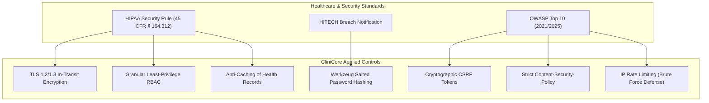

# Security Hardening & Defenses Architecture Document
## CliniCore EHR — Enterprise Healthcare Information & Data Protection Standards

---

### Document Control
* **Document Title:** Security Hardening and Defenses Specification
* **Project Name:** CliniCore EHR (Electronic Health Record & Medical Registry System)
* **Version:** 1.0.0 (Production Release)
* **Status:** Approved / Active
* **Date:** November 24, 2026
* **Classification:** Highly Confidential — Engineering & Compliance Specification
* **Target Audience:** Security Engineers, Compliance Officers (HIPAA/GDPR), DevOps Architects, Healthcare IT Administrators

---

## 1. Executive Summary & Security Philosophy

**CliniCore EHR** manages Protected Health Information (PHI), clinical diagnoses, medication histories, patient demographics, and billing transactions. In healthcare software, the compromise of confidentiality, integrity, or availability directly impacts patient welfare, clinical decision-making, and regulatory compliance.

The platform follows a **Defense-in-Depth (DiD)** and **Zero-Trust Architecture**:
1. **Never Trust User Input:** Every parameter is strictly sanitized, bounds-checked, or validated through parameterized queries.
2. **Fail-Closed Authorization:** Access to clinical features is prohibited by default unless explicitly granted by Role-Based Access Control (RBAC).
3. **Data Protection at Rest and in Transit:** All network traffic across public internet boundaries is encrypted with TLS 1.3/TLS 1.2.
4. **Zero PHI Client Leaks:** Medical records are explicitly prevented from remaining cached on public terminals, shared clinic computers, or intermediate proxy servers.

---

## 2. Regulatory & Healthcare Compliance Alignment

CliniCore's security controls are aligned with international healthcare cybersecurity frameworks:



* **HIPAA Technical Safeguards (§ 164.312(a)(1)):** Unique user identification, emergency access control, automatic session logoff after 2 hours.
* **HIPAA Transmission Security (§ 164.312(e)(1)):** Mandatory TLS certificate verification across serverless lambdas and cloud database clusters.
* **OWASP Top 10 Mitigation:** Explicit protection against Broken Access Control (A01), Cryptographic Failures (A02), Injection (A03), and Security Misconfiguration (A05).

---

## 3. Defense-in-Depth Security Matrix

| Layer | Defense Mechanism | Implemented Technology / File | Mitigated Attack Vector |
| :--- | :--- | :--- | :--- |
| **Transport / Network** | Mandatory TLS 1.3 / SSL Default Context | `database.py`, Vercel Edge SSL | Man-in-the-Middle (MitM), eavesdropping, packet sniffing |
| **Authentication** | Salted PBKDF2:SHA256 / scrypt with Dynamic Hash Upgrade | `app.py` (`login`), `users` table | Credential stuffing, dictionary attacks, rainbow table cracking |
| **Brute Force** | IP-Based Sliding Window Rate Limiting | `app.py` (`check_login_rate_limit`) | Automated password guessing, account lockouts |
| **Session Integrity** | Cryptographic Session Cookies (`HttpOnly`, `SameSite=Lax`, `Secure`) | `app.py` (`app.config`) | Session hijacking, Cross-Site Scripting (XSS) cookie theft |
| **Session Lifecycle** | Immediate Session Invalidation on Logout & Re-anchoring on Login | `app.py` (`session.clear()`) | Session Fixation, dormant session takeover |
| **CSRF Defense** | 32-Byte Cryptographic Hex Token with Constant-Time Comparison | `app.py` (`csrf_protect`, `verify_action_csrf`) | Cross-Site Request Forgery (CSRF), unauthorized state changes |
| **Authorization** | Strict Three-Tier Role-Based Access Control (RBAC) | `app.py` (`@require_permission`, `can()`) | Privilege escalation, horizontal/vertical IDOR |
| **Database Injection** | 100% Parameterized Prepared Statements | `app.py`, `database.py` (PyMySQL / MySQL Connector) | SQL Injection (SQLi), blind SQL injection, data tampering |
| **Input Parsing** | Strict Bounded Integer Sanitization | `app.py` (`safe_int`) | Numeric overflow, pagination crash exploits, parameter pollution |
| **Content Security** | Strict CSP, X-Frame-Options, X-Content-Type-Options | `app.py` (`apply_security_headers`) | Clickjacking, MIME sniffing, inline script injection |
| **Data Privacy** | PHI Cache-Control Suppression for Authenticated Users | `app.py` (`apply_security_headers`) | Sensitive health records cached on shared hospital terminals |
| **DoS Defense** | Max Request Body Clamping (2MB Limit) | `app.py` (`MAX_CONTENT_LENGTH`) | Buffer overflow, memory exhaustion, oversized payload DoS |

---

## 4. Deep-Dive Security Controls

### 4.1 Authentication & Credential Architecture
* **Salted Password Hashing:** User passwords are never stored in plaintext. They are hashed using Werkzeug's cryptographically secure key derivation functions (PBKDF2 with SHA-256 or scrypt) with cryptographically unique salts per user.
* **Transparent Hash Upgrading:** When legacy users authenticate, the system verifies their credential, automatically rehashes the password with the newest recommended cryptographic algorithm, and updates the database row in-place without user disruption.
* **Password Policy:** Enforces a minimum length of 8 characters during administrative user creation.

### 4.2 Brute-Force & Denial of Service Mitigation
* **Sliding Window Rate Limiter:** The authentication gateway monitors login attempts on a per-IP basis.
* **Lockout Threshold:** If an IP address registers $\ge 5$ failed attempts within 300 seconds (5 minutes), all further authentication requests from that IP are blocked immediately with a 429-equivalent lockout message.
* **Payload Clamping:** `MAX_CONTENT_LENGTH` is constrained to `2 * 1024 * 1024` bytes (2 MB), immediately halting abnormally large multi-part requests or Denial of Service memory exhaustion attempts.

### 4.3 Session Security & Anti-Fixation
* **Cookie Protections:**
  * `SESSION_COOKIE_HTTPONLY = True`: Blocks client-side JavaScript access (`document.cookie`), neutralizing credential leakage via XSS.
  * `SESSION_COOKIE_SAMESITE = "Lax"`: Instructs the browser not to send the session cookie on cross-origin requests, blocking CSRF attacks.
  * `SESSION_COOKIE_SECURE = True`: Forces transmission strictly over HTTPS in production environments.
  * `PERMANENT_SESSION_LIFETIME = timedelta(hours=2)`: Restricts clinical session exposure on unattended workstations.
* **Session Fixation Defense:** At the exact moment of successful authentication, `session.clear()` is called to flush any pre-existing session identifiers before establishing the authenticated identity.
* **Deterministic Serverless Secret Key:** In ephemeral serverless environments (Vercel Lambdas), session secrets are anchored to commit SHA or stable deployment tokens to prevent session drops while maintaining tamper-proof HMAC signatures.

### 4.4 Dual-Tier Cross-Site Request Forgery (CSRF) Protection
* **Tier 1 — Middleware Verification (`csrf_protect`):**
  Every state-altering HTTP method (`POST`, `PUT`, `PATCH`, `DELETE`) is intercepted by an `@app.before_request` hook. The incoming token submitted via form body (`csrf_token`) or HTTP request header (`X-CSRF-Token`) is validated against `session["_csrf_token"]`.
* **Tier 2 — Action-Level Verification (`verify_action_csrf`):**
  Sensitive or irreversible operations (e.g. patient deletion, marking follow-ups complete, user role modifications) require an explicit action token verification check before processing.
* **Timing-Attack Resistance:** Token validation is executed using `secrets.compare_digest(token, expected)`, eliminating side-channel timing attack vectors.

### 4.5 Role-Based Access Control (RBAC) Architecture
CliniCore establishes a formal three-tier clinical permission hierarchy:

```
[Admin]  ──> Full CRUD on all records + User & Credential Management
   │
[Doctor] ──> Full View & Edit of Patients, Encounters, Diagnoses, Labs, Meds, Follow-ups
   │
[Nurse]  ──> Patient View, Visit View, Lab Results Entry, Follow-Up Status Updates
```

* **Route Decorators:** Protected endpoints are guarded with `@require_permission("domain.action")`.
* **Zero Trust:** If an unauthenticated user targets an endpoint, they are redirected to `/login`. If an authenticated user lacks permission (e.g., a Nurse attempting to delete a patient), the system flashes an `Access Denied` error, aborts execution, and redirects to the safe dashboard.

### 4.6 SQL Injection (SQLi) Defense
* **100% Prepared Statements:** Every database query in `app.py` and `database.py` utilizes parameterized `%s` placeholders.
* **Zero String Formatting:** No SQL statement concatenates variables with f-strings, `%` formatting, or `.format()`.
* **Type-Cast Bounds Checking:** All incoming IDs and pagination offsets pass through `safe_int()`:
  ```python
  def safe_int(value, default=1, min_val=1, max_val=1000000) -> int:
      # Enforces strict integer conversion with upper and lower limit clamping
  ```

### 4.7 HTTP Security Headers & Browser Hardening
Every HTTP response is enriched with standard OWASP-recommended security headers:

* **Content-Security-Policy (CSP):** Restricts script, style, font, and frame origins strictly to `'self'`, Google Fonts (`fonts.googleapis.com`), and validated CDNs. Blocks framing by third-party origins.
* **X-Frame-Options: SAMEORIGIN:** Prevents the application from being embedded in malicious iframes, stopping **Clickjacking** attacks.
* **X-Content-Type-Options: nosniff:** Forces the browser to honor declared MIME types, preventing MIME-confusion exploits.
* **X-XSS-Protection: 1; mode=block:** Triggers browser-level XSS filtering in legacy clients.
* **Referrer-Policy: strict-origin-when-cross-origin:** Prevents sensitive URL parameters from leaking to external domains.
* **Permissions-Policy:** Disables high-risk hardware APIs (`geolocation=()`, `microphone=()`, `camera=()`).

### 4.8 Protected Health Information (PHI) Cache Suppression
To prevent patient health records from being viewed by unauthorized individuals who sit down at a shared hospital terminal after a doctor logs out:
* For all authenticated routes (`"user" in session`):
  ```http
  Cache-Control: no-store, no-cache, must-revalidate, max-age=0
  Pragma: no-cache
  ```
* Browsers and intermediary proxies are forbidden from writing patient pages to disk.
* Static assets (`/static/*`) are safely partitioned with `Cache-Control: public, max-age=31536000, immutable` to maximize CDN speed without exposing clinical data.

---

## 5. Security Incident Response & Exception Handling

* **Information Disclosure Prevention:** Production errors (403, 404, 500) render custom clinical error templates (`error.html`).
* **Stack Trace Shielding:** Database connection failures, internal logic errors, or library exceptions are never exposed to the client. The user receives a generic error code with a safe message, preventing reconnaissance by attackers.

---

## 6. Security Maintenance & Audit Checklist

| Routine Check | Frequency | Responsible Role | Tool / Procedure |
| :--- | :--- | :--- | :--- |
| **Dependency Vulnerability Scan** | Monthly | Lead Engineer | `pip-audit` / GitHub Dependabot alerts |
| **User Access & Role Audit** | Quarterly | Hospital Admin | Inspect `/admin/users` for inactive staff accounts |
| **Database TLS Verification** | Continuous | DevOps | Ensure TiDB SSL certificates are valid and enforced |
| **Secret Key Rotation** | Annual | Systems Architect | Update `SECRET_KEY` environment variable in Vercel |
| **Session & Log Review** | Weekly | Security Lead | Review login rate-limit events and abnormal 403 spikes |

---
*Document created and maintained under CliniCore Engineering Standards.*
